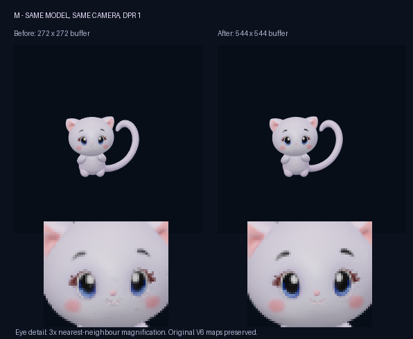
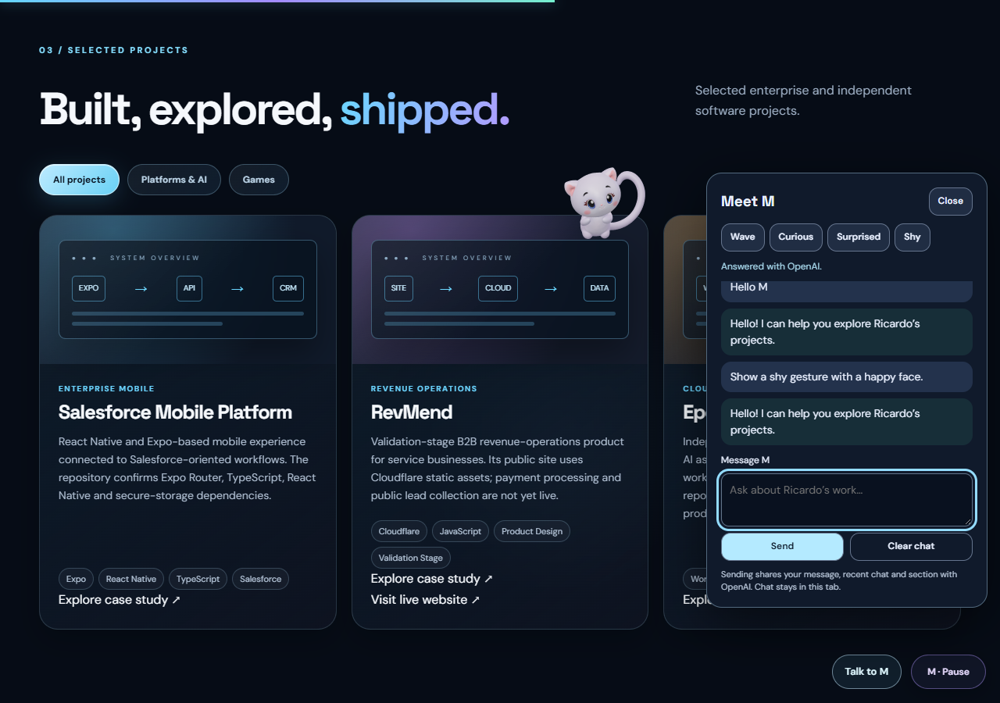

# M live fidelity and reaction fixes

Status: validated locally on the dedicated fix branch; not yet merged or published.
The original V6 GLB, ten detail maps, geometry, materials, UVs, 31-bone rig,
four skinning sets and six clips are unchanged.

## Reproduced causes and changes

- The published renderer and the important original face/eye maps matched the
  local files. Under identical settings, both origins produced identical neutral
  actor pixels. There was no evidence of GitHub degrading the textures.
- DPR-1 displays received only a 272 x 272 desktop framebuffer. M now renders at
  least 2x, bounded at 680 x 680 desktop and 416 x 416 mobile. CSS size, framing,
  lighting and materials remain unchanged. In the same neutral-camera test,
  DPR-1 pixels now exactly match the previous DPR-2 reference; the masked RGB
  RMSE fell from 7.36 to 0.
- Enter submits through the existing form handler. Shift+Enter inserts a newline.
  IME composition, held Enter, disabled inputs and pending requests cannot cause
  an extra submission.
- A requested gesture could wait about 24 seconds behind a project card, lose
  its requested expression before appearing, or be replaced by spontaneous life.
  Explicit requests now outrank autonomous gestures and use a nearby real depth
  gate before acting at a visible, stationary location. Requested expressions
  remain active for the action. Expression-only replies use the same safe staging.
- A gesture's default expression previously overrode the assistant's separate
  expression field. The renderer now honors the supplied expression and reports
  the actual V6 facial adapter expression for validation.
- The free-roaming fallback chose from only three fixed points. It now finds
  clear corridors around real text/control rectangles and recent destinations,
  moving between equally safe choices. Full-envelope depth gates and protected
  masks remain unchanged.
- The system reduced-motion preference intentionally parks M at bottom-right.
  Normal desktop observations also visited left/centre/right cards, so the
  owner's exact browser preference cannot be inferred from a screenshot.
  The companion now explains reduced motion and offers **Enable M motion**.
  This requires an explicit click, applies only to the current tab session,
  never resumes a paused character, and is revoked on a system preference change.
- All first-party M runtime queries and the HTML entry point use revision 25.
  A regression check prevents inconsistent/unversioned imports on future
  revision changes.

## Visual evidence

Both columns use the same original model, camera, lighting and CSS size.
The lower detail is a labelled nearest-neighbour magnification, not a replacement
texture or an AI-generated image.

A real 100-second mobile Chrome observation recorded left/centre/right motion.
All 100 hero samples kept the neutral body clear of protected text and controls.
Projects retained two genuine behind-card peek cycles.

This capture uses a mocked API reply and the real V6 facial adapter/body rig.
The requested happy expression remains active during the separate shy gesture.

## Validation

Native Chrome 156.0.8078.73 was used with hardware WebGL and native RAF.
The quality matrix covers desktop DPR 1/2.5 and mobile DPR 1/3, responsive resize,
all ten restored maps, 31 bones and up to fourteen influences.

Measured native render FPS was approximately 60 for all four quality profiles;
controller CPU p95 was 2.7-2.8 ms on this computer. This is an approximate desktop
measurement with mobile emulation, not a physical-phone performance guarantee.
The driver can emit informational constant-folding precision warnings; no shader
failure or visual artifact was observed.

All browser conversation fixtures intercept the API and block unintended real
OpenAI requests. These fixes do not redeploy or modify the Worker.

- Node regression: 210/210 passed.
- Native quality matrix: 21/21 passed.
- Native consent, expression-only, mixed expression/gesture, short viewport and tap: 28/28 passed.
- Existing native navigation, occlusion, touch and scroll smoke: 29/29 passed.
- A final long-chat test caught 35.4% of the neutral actor behind the mobile panel. Staging now prioritizes neutral visibility and treats the header as a protected mask within reachable viewport bounds. The focused 582-character reply test passes with 0% actor/panel overlap.
- Final native gestures, keyboard, consent and long-chat suite: 88/88 passed.
- Final native real routes after the visibility correction: 51/51 passed, including continuous front reentry, behind-card recovery, viewport changes and touch.

Runtime files changed: index.html (cache only), m-world-3d.mjs, scroll-buddy.js,
m-world-companion.mjs, m-world-spatial.mjs and the new m-world-action-policy.mjs.
The accompanying Node/browser regressions and these validation notes are included.

## Local review

1. Open the local site at http://127.0.0.1:4183/ and reload it.
2. Observe M around the hero, then scroll to projects and allow complete routes.
3. Open **Talk to M**. If shown, select **Enable M motion** to opt in.
4. Try Wave, Curious, Surprised and Shy while M is behind a card.
5. Type a message: Enter sends once; Shift+Enter inserts a newline.
6. Pause/resume M and check that navigation and project links remain clickable.

## Limits

- The owner's current browser motion preference and display DPR were not
  directly inspected; reduced motion is a reproduced supported case.
- Mobile/touch and IME events were emulated. Physical Android/iOS, physical IME
  keyboards and Safari still require checks.
- Safe staging can take several seconds when M must genuinely clear a card.
  It does not teleport or change depth through a component.
- Reading, an open conversation, page visibility and explicit pause still govern
  spontaneous exploration. This preserves the existing quiet interaction policy.
- Public deployment requires the owner's explicit approval under the supplied
  Git/release instructions.