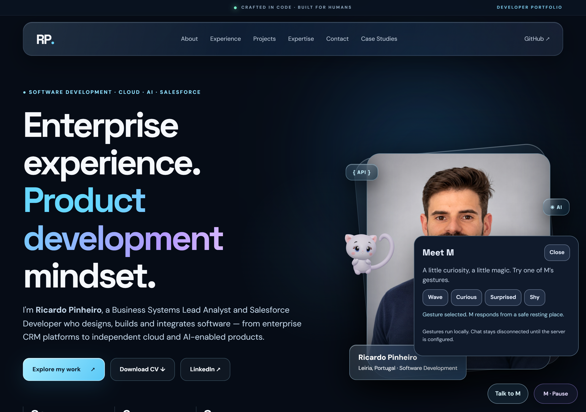
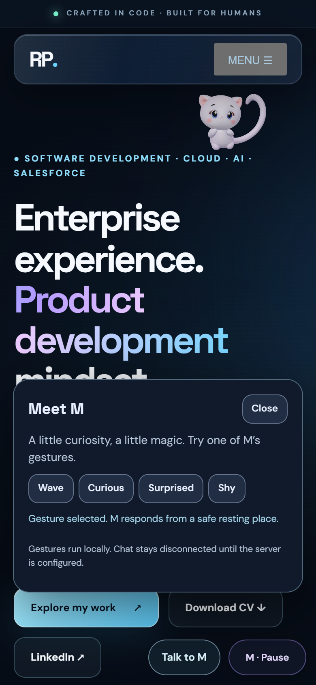

# M World V22 — Acting, context and optional OpenAI companion

V22 was published through PR #2 on 2 November 2026, merge commit `32dbcc1`, after explicit approval. Activation adds the verified Cloudflare endpoint and a request-scoped quota transport fix. Original V21 remains preserved in Git history.

## Implemented

- Four real-time gestures over the original V6 rig: wave, curiosity, surprise and shyness. Each has anticipation, action and recovery, bounded joint rotations and delayed secondary motion. The reversible quaternion layer is removed before the existing mixer/motion layers and reapplied afterwards, preventing drift. These are procedural web gestures, not newly exported GLB animation clips.
- Gesture poses join the renderer's correlated framing samples. The source model, all skin influences, textures, morphs, shoulder correctives and six original clips are unchanged.
- Context-aware target scoring considers visibility, reading protection, proximity and recent visits. Successful arrivals enter a 24-target session memory with visit cooldowns. Reading, typing, scrolling and an open companion panel defer new spontaneous intentions; existing safe movement continues.
- Visitor gestures wait for a visible, stationary resting place instead of interrupting a depth portal. Safety recovery remains allowed when attention is quiet: if scrolling invalidates a behind-card route, M first leaves the geometry, returns to front depth and then performs the queued gesture.
- The optional Talk to M panel exposes gestures, keyboard/Escape support and an explicit-send chat. With no configured endpoint, only local gestures are presented. No AI call happens on page load, pointer movement, scrolling, idle or opening the panel.
- OpenAI replies are plain text plus validated expression/gesture/section enums. Facial expression can change independently of a gesture. A section hint becomes a visitor-clicked local control; the model cannot execute navigation, URLs, selectors or scripts.
- The Cloudflare Worker uses the Responses API, a curated snapshot of public portfolio facts, server-only credentials and `store:false`. Atomic SQLite Durable Object limits coordinate requests and concurrent leases across isolates. Cancellation, timeouts and upstream failures release leases and return bounded errors.

## Validation

- 184 Node tests passed, including the original asset/homepage fingerprints, 34 backend tests, gesture reversibility over real quaternion composition, contextual memory and input validation. Backend tests use mocked OpenAI responses and real local SQLite.
- The existing 29-check native Chrome suite passed in desktop 1280x900@2 and mobile/touch emulation 390x844@2. It exercised original skinning, source detail maps, actual GPU depth/text masking, mobile navigation and perching during scroll. A real perch recorded its successful target in the new session memory.
- Warm native desktop-GPU cadence remained about 60 FPS in both viewport profiles. This is a short PC measurement, not physical-phone performance evidence.
- A separate native Chrome fixture passed 42 checks and exercises all four desktop gestures and wave/curiosity on mobile, observes their rig phases, checks local-only traffic, keyboard controls, independent expressions, and rejects a malformed remote action. API replies in that fixture are explicitly mocked. It also reproduced a real behind-card route interruption while the panel remained engaged: the corrected desktop recovered front depth in 4.95 seconds and began the queued wave at 9.80 seconds; mobile recovered in 2.61 seconds and waved at 6.46 seconds. Neither profile chose a new card during that recovery, and visit memory was preserved.
- Official Wrangler 4.156.0 compiled the Worker, and bundled workerd started it successfully. `/health` returned 200/configured false; a no-key chat request failed closed with 503. Runtime entry exports and the request-signal compatibility flag were verified. These preliminary no-key fixtures preceded the approved production deployment and live API checks described below.

The hosted software-GPU browser suite retains the V21 logical-clock scope documented in its report. The separate gesture recording below uses native Chrome timing and real rendering.

## Evidence

[Gesture recording](gestures.webm) — real production gesture queue, original rig and fixed browser viewport.

| Desktop wave | Mobile wave |
| --- | --- |
|  |  |

## Reproduce

~~~powershell
node --test m-lab/interactions/*.test.mjs m-world*.test.mjs m-ai/*.test.mjs
# Start a static server on 127.0.0.1:4183, then:
$env:BASE_URL='http://127.0.0.1:4183/'
node m-world-browser-smoke.mjs
node m-world-intelligence-browser.mjs
~~~

The intelligence browser fixture uses the installed Chrome executable and native timing. It does not replace the hosted software-renderer smoke suite. Report artifacts identify mocked chat responses separately from real animation/rendering.

## OpenAI activation

The owner approved the Worker deployment and entered OPENAI_API_KEY directly as a Cloudflare secret. The verified service is https://m-portfolio-companion.ricardopacheco-pinheiro.workers.dev, with the public chat endpoint /api/m/respond.

Production checks confirmed health 200, exact CORS preflight 204 and rejection of an unrelated origin with 403. A real Portuguese portfolio question returned a structured answer with expression/gesture enums. A real Chrome greeting sent no request before explicit Send, then received HTTP 200 and performed the returned wave on the original 31-bone, 14-influence rig without JavaScript errors or browser Authorization headers.

The first configured request exposed a cached-stub transport failure before the provider call. The adapter now creates a new stub for each operation, retaining the same global singleton, atomic limits and no-retry reservation policy. New regressions reproduce request-context and poisoned-stub failures; live requests pass after the fix.

The independent browser fixture isolates both local-only and mocked-chat pages, blocking unmocked AI calls. Its long-reply check also identified a mobile layout issue; the connected panel keeps M visible and its input/actions accessible with an independently scrolling conversation log.

[Worker setup, usage limits and HTTP contract](../../m-ai/README.md). No credential was requested, inspected or committed. Request/token limits are not a monetary spend guarantee. Chat is triggered only by explicit visitor submissions; the model suggests bounded expressions, gestures and user-clicked section hints.

## Remaining limits

- Owner review of gesture appeal and timing; an actual Android/iOS phone and Safari.
- Longer live evaluations, real mobile keyboards, quota-exhaustion/abuse behavior and usage costs over time. The initial deployed Worker and real OpenAI conversation have been checked.
- The original actor payload remains heavy on slow/mobile connections. No destructive mesh or texture optimization was introduced.
- Quietness is inferred from interaction and text selection; it cannot establish whether someone is actually reading. Session memory resets on reload.
- Local behavior remains deterministic and responsive without AI. Model replies may still require factual review despite public-context grounding and schema validation.

## Changed files

- `scroll-buddy.js`, `m-world-brain.mjs`: contextual intentions, short memory, gesture queue and safety recovery.
- `m-world-acting.mjs`, `m-world-3d.mjs`: reversible real-rig gestures and framing.
- `m-world-companion.mjs`, `m-world-config.mjs`, `m-world.css`: optional controls, text-only chat and URL configuration.
- `m-ai/`: Worker, SQLite quota, local adapter, public facts, tests and setup documentation.
- `index.html`: two mascot cache versions only; all original content and destinations are fingerprint-protected.
- `.gitignore`, tests and workflow: protect secret/runtime files and include backend regressions.
