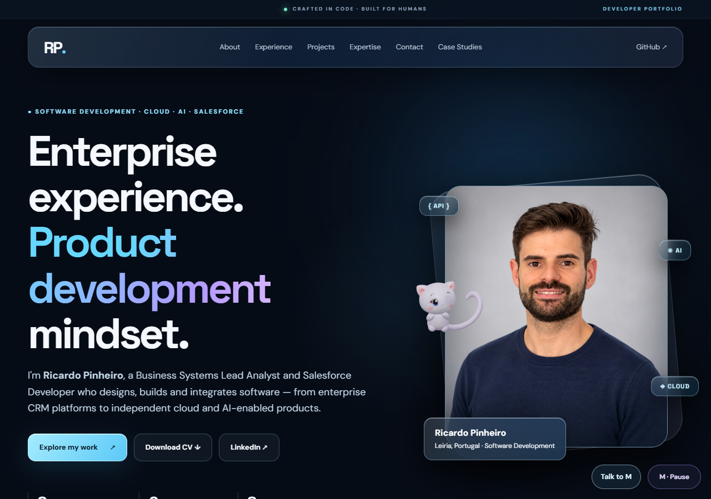
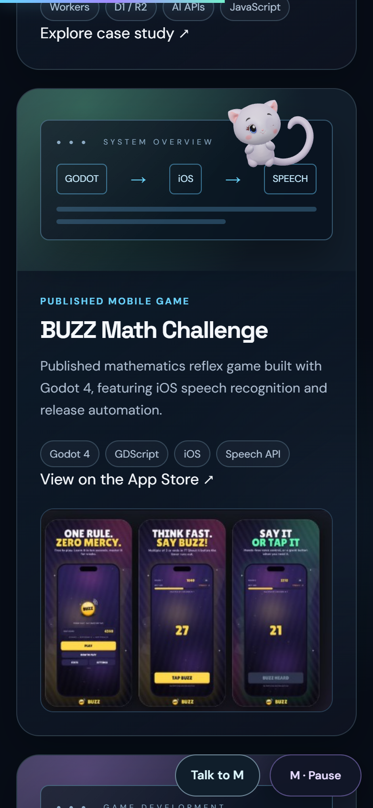
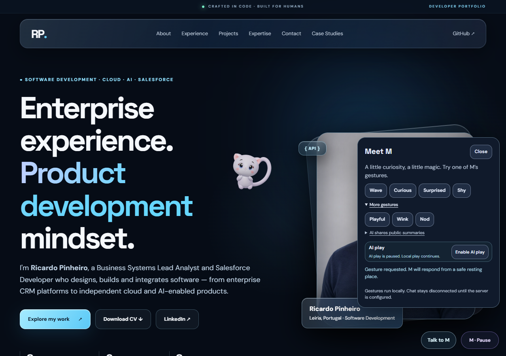
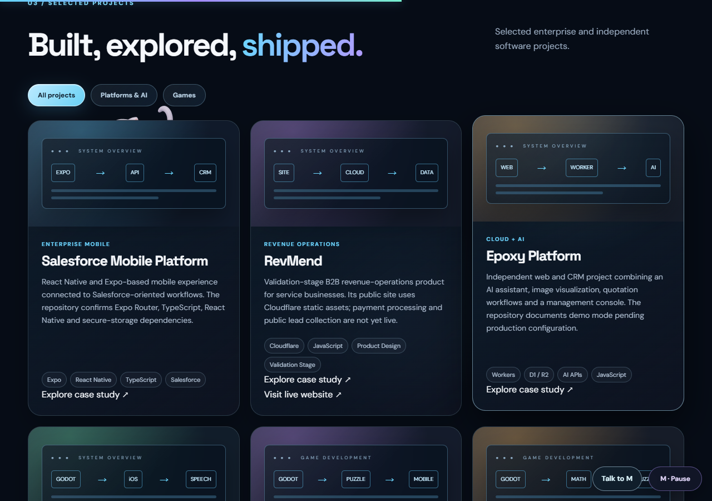
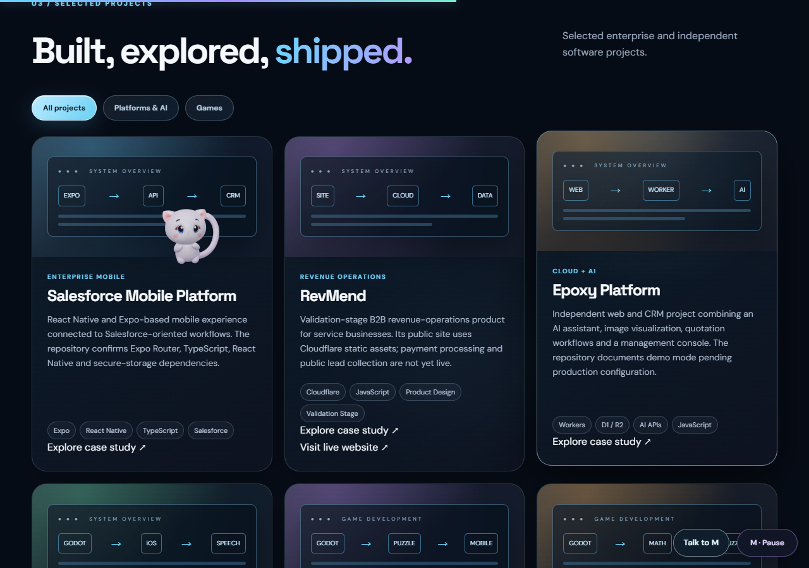

# M World V23 — Living motion and bounded automatic AI play

Status: prepared on feat/m-living-companion-v23; not published. V22 remains live.
The owner requested automatic AI with limited calls. Production activation and a
real new director response remain pending explicit publication approval.

## Visible changes

- Frame-rate-independent acceleration, continuous arrival and turn anticipation.
  Head, chest, ears and all ten tail joints respond to acceleration with small,
  reversible offsets. Support motion settles smoothly rather than reusing stale
  acceleration on takeoff.
- Seven local gestures: Wave, Curious, Surprised, Shy, Playful, Wink and Nod.
  New gestures have anticipation, action and recovery; their shoulder maxima
  remain below the previously validated Wave. The source model/rig is unchanged.
- Wink uses the original independent eye HAT morphs. Diagnostics read actual
  morph weights; the opposite eye remains open and automatic blinking resumes.
- Automatic AI can select a real visible component, a legal interaction, a
  gesture and an expression. The spatial planner rechecks every action locally.
  A cancelled route never records a false arrival or triggers a follow-up gesture.
- AI has an independent pause control that persists for the tab session.
  Visitor actions and chat outrank automatic suggestions. Local play continues
  when AI is unavailable or its budget is exhausted.
- The original V6 GLB, 31 bones, four skinning sets (up to fourteen influences),
  shoulder correctives, six source clips, UVs, textures and materials are intact.
  Homepage content, links and navigation are protected by the original fingerprint.
- Runtime imports use cache revision 26, including the updated facial adapter.

## What AI receives and controls

The observer summarizes up to eight visible, known portfolio components: ID,
public heading, kind, coarse screen zone and currently offered actions. It also
supplies section/language, the attention target and six recent completed actions.
It never sends form values, drafts, chat messages, page HTML or screenshots.

The new POST /api/m/direct returns only snapshot revision, target ID, action,
gesture and expression. Allowed actions are inspect, peek, perch, orbit and rest.
The model cannot issue scripts, coordinates, links, clicks or navigation.

The existing chat endpoint retains its original four-field contract and gestures.
New local gestures and the automatic director are independent of that legacy
chat response format. The Cloudflare secret stays server-side.

The backend uses the existing Responses integration and a strict JSON schema,
then validates target/action pairs against the supplied snapshot. See
[official Structured Outputs documentation](https://developers.openai.com/api/docs/guides/structured-outputs).

## Request budgets and lifecycle

- Client: at least 65 seconds between attempts; six attempts per tab session.
  Failures and cancellations consume attempts. Reload and pause do not reset them.
- Server: one director attempt per IP/minute, twenty globally/hour and eighty/day,
  atomically combined with the existing chat/global limits and concurrency leases.
- API work is deferred or cancelled while paused, hidden, typing, reading,
  scrolling or handling an explicit visitor interaction. Motion remains local.
- Missing reliable session storage keeps automatic API work disabled.
- A cancelled free health check can retry after quiet; actual unavailable/offline
  responses retain a five-minute backoff.
- AI_AUTOPLAY_ENABLED remains false in the checked-in Worker configuration.
  Enabling it requires the approved Worker deployment before the frontend release.

## Visual evidence

The AI decisions in these captures were explicitly mocked. The actual model,
morphs, rig, movement, component geometry and WebGL depth rendering were real.

[Playful short preview](playful.webm) · [Nod short preview](nod.webm)

Both previews contain about 2.2 seconds of their action phase, not a complete
cycle. Native Chrome decoded sixty-five frames from each. The empty 110-byte
Wave recording was excluded.

## Executed validation

- Node: 273/273, including legacy geometry, rig, expressions, chat and quota tests.
- Native Chrome V23: 40/40 executed checks. Two real hidden-tab checks are
  unverified: Chrome headless kept document.hidden false. They are not passes.
- Physical AI route stories: 21/21. A mocked decision chose Salesforce Mobile
  Platform; real peek and Playful followed. All 30,420 interior card pixels stayed
  unchanged while 1,597 actor pixels remained visible outside. Both depth changes
  happened with no overlapping card. Scrolling to Contact cancelled another route
  with no false visit, follow-up gesture or extra request.
- Legacy native Chrome smoke: 29/29.
- Legacy gesture, chat, keyboard and consent regression: 88/88.
- Native render-quality matrix: 21/21.
- Legacy shoulder/expression and consent regression: 28/28.
- Worker: cached Wrangler 4.156.0 dry-run, syntax and exports passed.
  Bundle 30,910 bytes, gzip 9,751 bytes; no upload, deploy or paid request.
- No real OpenAI request was made for this feature validation.

### Warm Chrome performance

| Profile | Render FPS | Frame p95 | JS/render CPU p95 |
| --- | ---: | ---: | ---: |
| Desktop DPR 1 | 60.0 | 18.5 ms | 2.6 ms |
| Desktop DPR 2.5 | 60.1 | 18.5 ms | 3.2 ms |
| Mobile emulation DPR 1 | 60.0 | 17.8 ms | 2.7 ms |
| Mobile emulation DPR 3 | 59.7 | 17.8 ms | 2.5 ms |

These are warm, desktop-GPU measurements, not physical-phone or GPU timing proof.
Chrome reported roughly 160–191 MB of page heap, including the source model.
The CSS canvas stays unscaled/unfiltered; desktop framebuffers are 544–680 px,
and mobile is bounded at 416 px. No asset compression or quality downgrade was used.
## Local review

1. Open http://127.0.0.1:4183/ and reload.
2. Observe the smoother departures/arrivals and scroll through components.
3. Open Talk to M, then More gestures, and try Playful, Wink and Nod.
4. Test Enter/Shift+Enter, pause, motion consent and the original navigation.
5. The public Worker still lacks the new enabled capability: local automatic AI
   correctly reports unavailable until the approved backend activation.
   The captures above demonstrate the integrated path with explicit test replies.

## Remaining validation

- One real director response with the configured Cloudflare/OpenAI secret after
  approval; validate schema acceptance and appearance on the published site.
- A normal foreground/background Chrome window, physical phones, Safari/iOS and
  physical IME keyboard checks.
- Mobile FPS measurements so far use desktop-hosted touch/mobile emulation.
- New gestures are runtime additive animation, not new exported GLB clips.