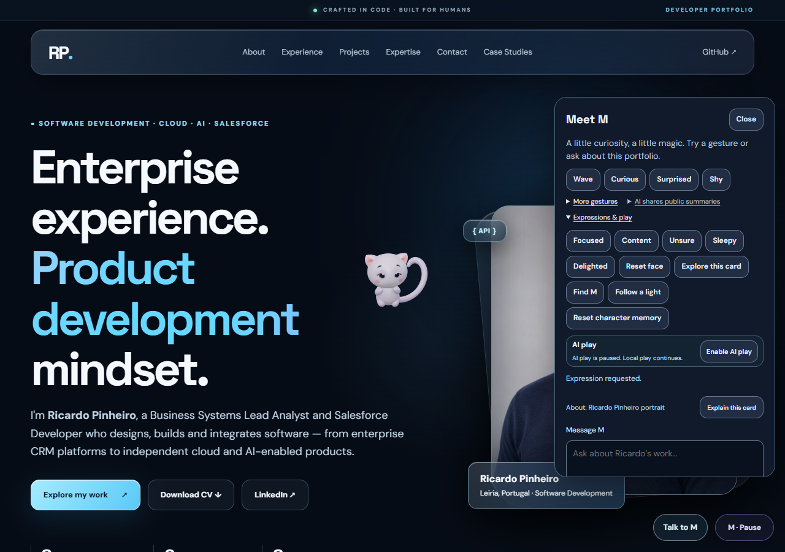
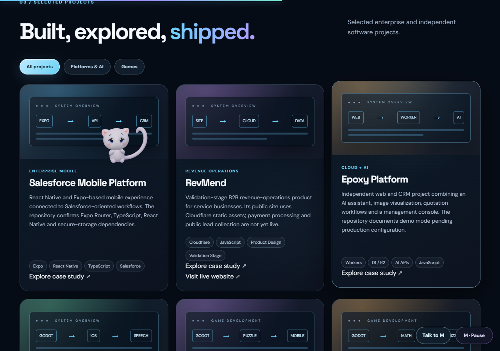
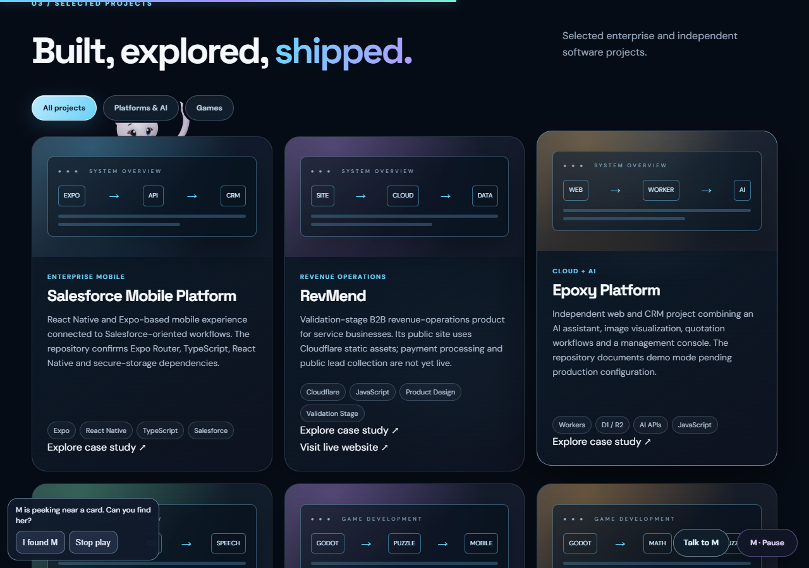
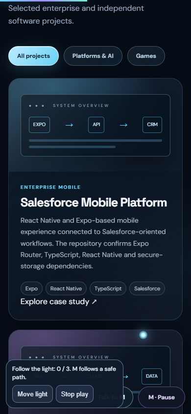
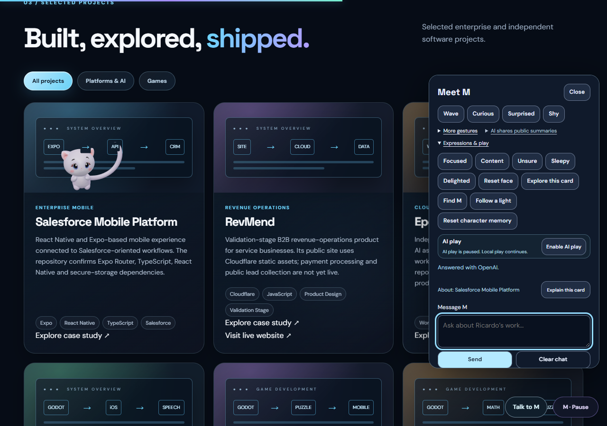

# M World V24 — Validation and review

Status: implemented on feat/m-intent-scenes-v24; not published. V23 and its
Cloudflare Worker remain live. V24 does not change original model assets.

## Implemented behavior

- One intention expands locally into Look, Travel, React, an offered Perch and
  Rest. The existing spatial planner revalidates every travel step. Routes and
  gestures require real completion acknowledgements; cancellation cannot create
  a successful visit. Steps are bounded at 35 seconds and scenes at 70 active seconds.
- Original-morph blends: Focused, Content, Unsure, Sleepy and Delighted. Blends
  sum to at most one, keep shoulder slots intact and use the original eye HATs.
  Wink has priority. These are combinations of existing art, not newly sculpted
  facial targets. Sleepy/Unsure are marked; the other states are deliberately subtle.
- A fixed catalogue of 22 public component IDs anchors 'this card/project' chat.
  Public project, experience, expertise and about headings are recognized. Other
  components fall back to section context. No arbitrary DOM or form text is sent.
- Find M pauses at an actually reached peek reveal for at most eight seconds;
  I found M is enabled only there. Follow a light uses three safe corridor goals
  and actual arrivals. Moving the light never grants a score. Both games are
  optional, keyboard/touch accessible and have Stop play controls.
- Tab memory records bounded public IDs, visits, dwell and scroll pace. Familiarity
  varies local choices; recent real pointer attention can temporarily take priority.
  Clearing it cannot clear AI counters, the chat or AI preferences.
- AI still chooses high-level intentions with the existing six-attempt/65-second
  client budget and existing server quotas. A whole local scene adds no API call.

## Compatibility and interaction fixes

Chat still returns the original four fields. The backend accepts the old context
or an optional allowlisted component. The client checks contextualChat.version=1
from free health before including it; an old Worker receives the old context.
A response has one animation owner so its legacy gesture cannot cancel the new
contextual scene. Automatic focus on an empty chat field does not cancel a reply;
new typing does. Explicit visitor gestures override scenes.

Closing the panel can synthesize a pointerover on text behind it. A 250 ms guard
ignores only that transition. Actual scroll, focus, typing, selection, visibility
and reduced motion still interrupt autonomous activity. Cancelling a scene also
releases gesture staging, facial Infinity ownership and finite scheduling.

The native reduced-motion test found a residual Sleepy closure. The static frame
now opens the original HAT channels and settles only the facial blend. Observed
closures fell from about .46/.45 to zero, weights to numerical zero, and the pose
stayed fixed. Static redraws caused by legitimate layout invalidation are allowed.

## Executed tests

- 319/319 Node tests: model/HTML fingerprint, full skinning, facial layers, 2,700+
  composition frames, scene acknowledgements/timeouts, actual controller VM,
  legacy/new chat contracts, quotas, storage isolation and privacy boundaries.
- Native Chrome desktop integration: 25/25. A mocked AI decision expanded into a
  completed physical scene without another decision request.
- Native Chrome touch/mobile emulation: 25/25, including actual pointerType touch,
  both games, context, Enter/Shift+Enter, memory reload/reset and overflow checks.
- Final native desktop: 14/14, rechecking reduced-motion neutrality, stationary
  pose, the full scene and contextual chat after the final corrections.
- Five desktop affect states and their native video were checked in the first
  desktop pass. Its later scene-interruption failure is preserved as a diagnostic;
  subsequent fresh integration/final passes verified the correction.
- Worker dry-run succeeded with cached Wrangler 4.156.0. No deploy, secret read,
  new credential or model change occurred in this V24 preparation.
- Existing Chrome smoke passed after a perch-hold fix: its resting clock now starts at actual foot contact, including slow arrival and subsequent scroll. Hosted CI results are recorded with the PR.

All provider, chat and health responses in the new V24 browser QA are explicitly mocked. An older action harness was found to lack director isolation and may have contacted the existing V23 Worker; its exact live count was not recorded. It now replaces the public config and blocks both API routes before navigation. The new contextual Worker was never deployed or called live.
The model, RAF, morphs, skinning, routes, touch events and WebGL rendering are real;
there are no forced scene arrivals, pose clocks or generated substitute images.
Original V6: 31 bones, ten tail bones, fourteen maximum influences across four
sets, ten restored detail maps and six source clips. Source GLB SHA-256 remains
 a7eb2004bc4f2b3dd33393a3fd655bb3b821c35ddc6a2ae053c3a9b0dbd69b29.

Warm desktop-GPU measurements: about 60 FPS; desktop CPU p95 3.2 ms/frame p95 18 ms,
mobile emulation CPU p95 2.7 ms/frame p95 17.5 ms. They are not physical-phone or
thermal measurements. New CI checks exercise the actual reduced-motion, scene and
context contracts with mocked provider responses.

## Captures and preview

[Five-second native Sleepy preview](sleepy.webm). The clip is a short state/recovery
sample, not an entire scene. Chrome decoded 101 frames at 544x544.

## Local review

1. Open http://127.0.0.1:4183/ and reload.
2. Talk to M > Expressions & play exposes the five affects, Explore this card,
   Find M, Follow a light and the separate character-memory reset.
3. Scroll to Projects and try Explore this card. Its panel closes to give M space.
4. Use I found M at the reveal or Move light/Stop play in the optional game dock.
5. Explain this card names the active component. Until V24 Worker approval and
   deployment, the current public Worker receives the compatible legacy request.
6. Check reduced motion, pause, navigation and ordinary links independently.

## Remaining limits and release gate

Physical phones, Safari/iOS, physical IME and actual background-tab checks remain
unverified. Subtle blends remain limited by the original morph art. Voice is a
following phase. No new Blender rig, GLB clips or realistic facial sculpture was
created. Unknown catalogue components receive section-level context.

Release needs explicit approval under the owner's AGENTS.md. Deploy the compatible
Worker first with its existing true AI flag/secret/quota singleton, validate one
real contextual response, then merge the reviewed PR and validate GitHub Pages.
The earlier V23 approval does not authorize this new deployment.
