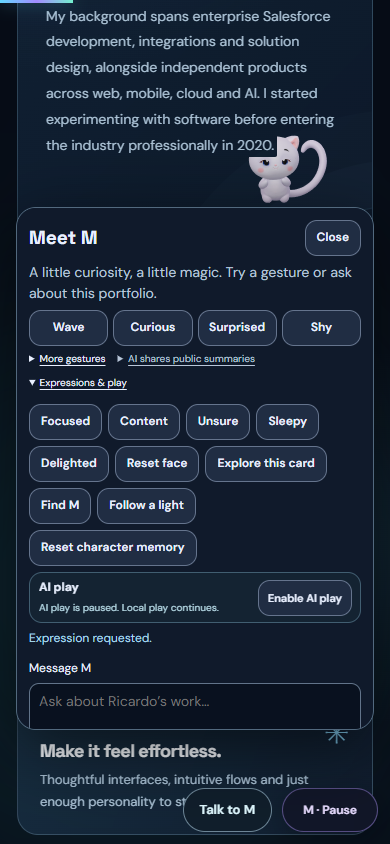
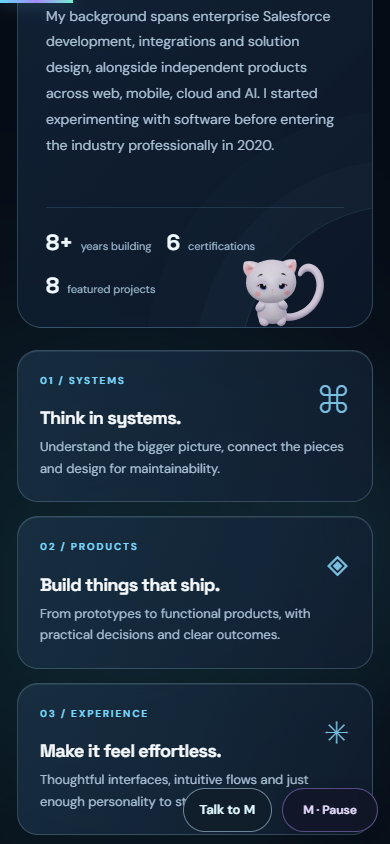
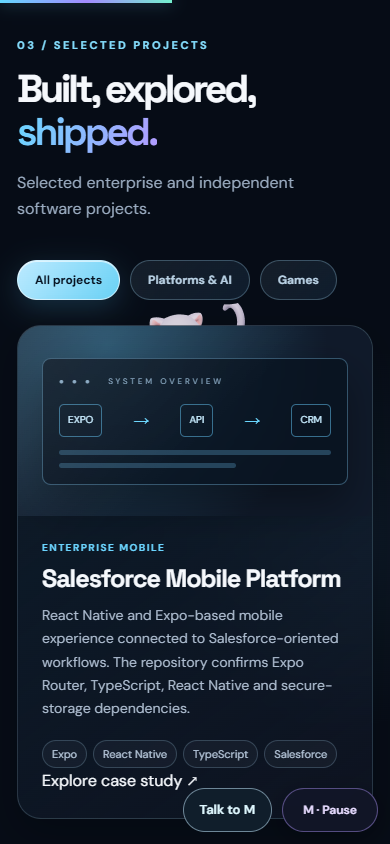
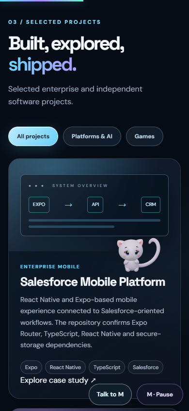

# V24 visibility follow-up

Status: prepared on `fix/m-mobile-presentation-v24`; not yet published.
The original V24 was approved and published through PR #7 on 3 November 2026,
merge `8cc84d42ff47b67a52bfc5e7c6bf8f89f2aa9a79`, cache revision 27. The Worker
version is `ee7eab6d-aaa6-427f-bcea-788ef0d86c2b`; one intentional real contextual
Epoxy request returned HTTP 200 in about 6.5 seconds, without reading or replacing
the secret. Existing automatic-AI limits and SQLite quota storage were preserved.

## Visual findings

The public native run checked the exact 16 runtime sources, original V6 rig and
detail maps, real Worker health, actual routes, optional games and touch controls.
It returned 39/41; two original assumptions were corrected in a focused 26/26
observation: an Unsure sample coincided with a natural blink, and a 390px viewport
did not offer a safe perch on the selected card. The diagnostic reports are kept.
These overlapping runs are not a combined 65 unique checks.

Reviewing the actual captures found two additional visual defects that numeric
checks had missed:

- Reduced motion after a behind-card game retained negative depth and hid M.
- An open compact companion drawer left insufficient presentation space and the
  protected-text mask cropped M's head during a requested expression.

## Prepared changes

Reduced-motion settling now chooses the existing safe neutral staging position,
restores front depth on its first static frame and releases stale surface/attention
ownership. It preserves text masks, focus and the absence of continuous animation.
On screens at most 720px wide, an accepted local gesture or expression closes the
drawer and returns focus to its toggle before actual staging. Drafts and an in-flight chat response remain intact; automatic presentation does
not cancel its pending request or steal focus when the reply arrives. Desktop
controls and rejected requests remain open. The model and masks are unchanged.
First-party imports use cache revision 28. No Worker change or paid request is needed.

## Validation

326/326 Node tests passed, including actual controller reduced-motion execution in
desktop/mobile fixtures, compact-panel behavior, draft/focus preservation, original
skinning and facial layers. Native Chrome regression passed 35/35 checks in desktop and touch/mobile profiles.
A further 14/14 reduced-motion-only observation required an actual partially
occluded body inside the viewport before switching motion off. These overlapping
runs are recorded separately, not presented as 49 unique checks. No provider
request was attempted, and no JavaScript or public-asset error was observed.

The captures were inspected: compact Unsure/Sleepy now show the complete head and
body; switching reduced motion on during an actual behind-card pose shows M
fully in front, neutral and stationary. The text masks remain enabled. Warm
three-second native samples measured 60.11 FPS / CPU p95 3.4 ms on desktop and
60.17 FPS / CPU p95 4.0 ms in mobile emulation. These are not phone measurements.

### Mobile expression: public defect and local correction

### Actual route, then reduced motion

Before changing the preference, the tail/body legitimately pass behind the card:

After changing the preference, M is fully visible, neutral and stationary:

Physical phones, Safari/iOS, physical IME and actual background-tab checks remain
unverified. Facial blends use the original art; voice remains a following phase.
