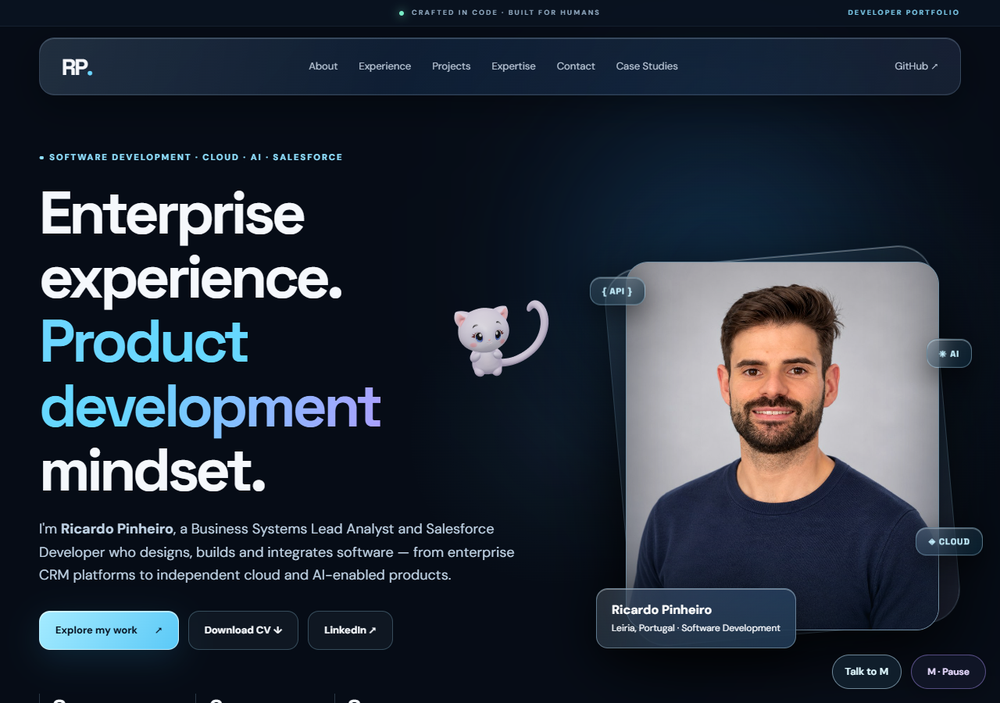
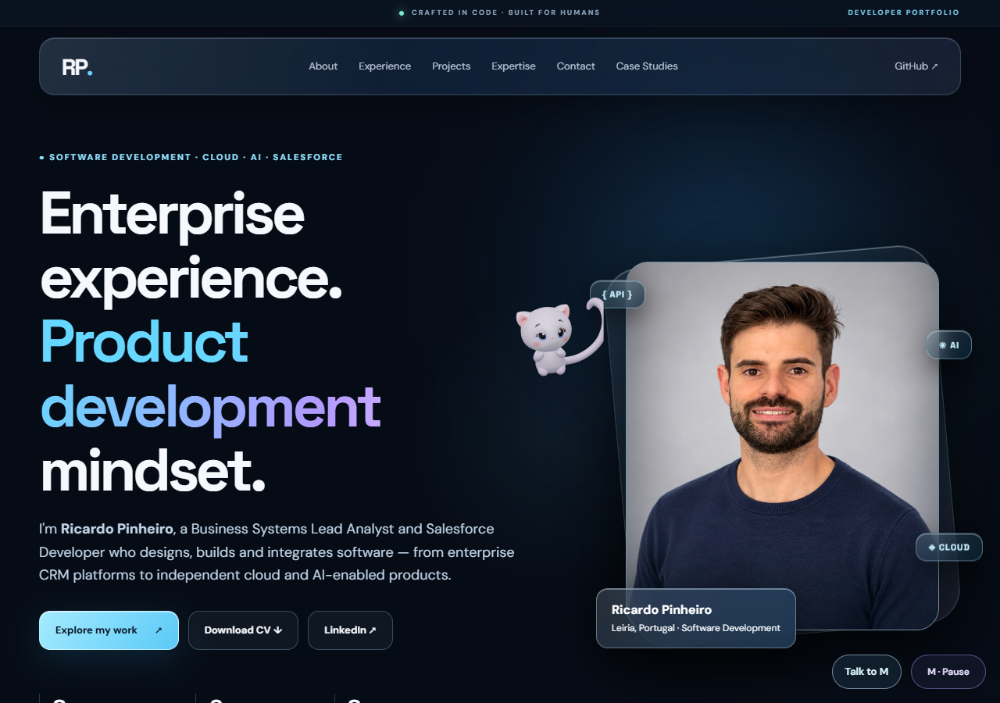
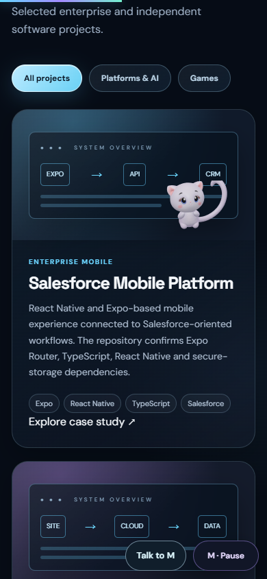
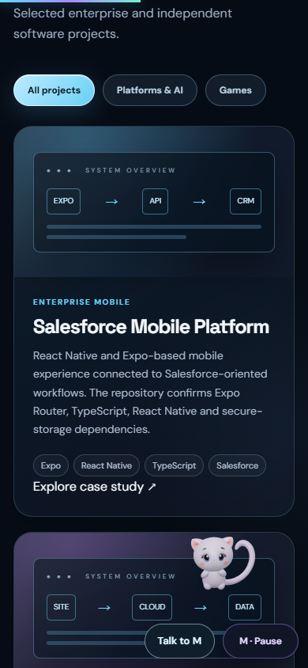

# M World V25 — Autonomous initiative

Pre-publication implementation and validation record, 3 November 2026.
Work branch: feat/m-autonomous-life-v25. Live release status is tracked in the PR;
this report does not itself authorize a merge or deployment.

## Behavior

M now chooses her own intentions without opening the companion or pressing a play
button. A normalized utility evaluator weighs novelty, proximity, visibility,
internal energy, fatigue and recent actions. It commits to one accepted intention
until the real executor completes it. Independent cooldowns and bounded history
prevent continuous rerolling or a fixed action carousel. Decisions run at most
once per second inside the existing single RAF owner.

Internal energy has its own baseline and activity/rest cycle. Visitor scroll pace
is only a small modifier; a motionless visitor no longer drains M's willingness
to play. A calm performance may first reach a safe presentation spot when the
visitor is not actively reading. During reading it stays in place or waits for
safe room. Typing, selection, scrolling, hidden state, pause and reduced motion
interrupt autonomous execution. Manual actions take priority and retain their
own route/gesture ownership.

M can inspect, peek, orbit, perch, quietly watch, rest, chase a self-generated
light and play a short peek-and-return routine. Autonomous games require no find,
move-light or start input, and never show the optional human game dock. Light
scores require actual arrival; scene visits and achievements require actual
completion. Failed proposals cannot manufacture a successful visit. Original
explicit play controls remain available for optional interaction and diagnosis.

## Expression and motion

Four original-morph performances were added: Anticipation, Mischief, Proud and Calm.
Together with the earlier five, there are nine non-neutral performances. They use
only original Happy/Curious/Surprised and HAT channels, with bounded weights,
asymmetry, temporal evolution and neutral endpoints. No geometry, textures,
materials, source clips, eye scaling or new facial sculpture were introduced.
Expressions start at actual visible gesture/reveal moments and recover smoothly;
they are not spent while M is still travelling to an acting spot.

The original V6 asset, 31 bones, 10 tail bones, four joint/weight sets (maximum 14 influences),
ten restored maps, six source clips and shoulder correctives are preserved. Existing
locomotion, full skinning, depth gates and protected-text masks remain authoritative.

## OpenAI

The existing automatic high-level director remains optional and bounded: 6 attempts
per tab, at least 65 seconds apart, with the existing server limit 80/day. A complete
local routine adds no API call. Local completed component actions feed the existing
public recent-action field so the next AI proposal sees actual recent activity.
The wire contract, Worker, model, secret and SQLite quota namespace are unchanged;
no Worker deployment or new key is required for this change. Local initiative
continues with AI unavailable, paused or out of its request allowance.

## Executed validation

- 368/368 Node tests, including a six-minute deterministic decision timeline,
  real-controller ownership/quiet-reading/completion tests, independent energy,
  memory reset, optional UI, full skinning and original facial-controller layers.
- Native Chrome desktop/offline and one mocked remote intention: 49/49 checks.
- Final mobile/touch repetition with genuinely settled capture: 33/33 checks.
- A final review caught and repaired a lost explicit-tap bridge. Native mouse/touch
  regression checks passed 19/19 for single, double and repeated taps, actual
  renderer playback, and cancellation of autonomous ownership. Three new Node
  tests also preserve pause/reduced-motion guards and prevent legacy spontaneous
  actions from competing with the utility owner. This is a separate targeted run
  after the autonomous observations; the zero-input code path was unchanged.
- Each offline profile first observes about 70 seconds in Hero with no clicks,
  hover commands, scroll or M action calls; then ordinary scroll introduces the
  real Projects layout for a further observation. Movement, scenes, automatic
  hide/light games, physical light arrival and varied affects were recorded.
- One remote intention was mocked and executed through real local movement;
  after its completion, fresh local autonomous execution resumed. The six-attempt
  limit and 65 second spacing remained intact. No live provider request was made.
- Warm actual drawing remained about 60 FPS. Desktop CPU p95 was 3.0 ms; the first
  final mobile measurement was 3.2 ms. Mobile emulation is not a physical phone.
  Full per-profile measurements and decisions are in NATIVE_SUMMARY.json.
- Pause, selection, typing, explicit override, draft preservation, compact drawer,
  reduced-motion front depth, text/click protection and horizontal overflow were
  checked. No JavaScript or asset errors were observed.

The first final run was 79/80. Its one bad assertion labelled a body moving 109 px/s
as calm after a capture wait silently expired. The actual screenshot was reviewed;
the text mask was present. The raw record is retained. The capture guard now
requires three truly stationary, visible and text-clear samples, including actual
quiet facial holds. The 33/33 mobile repeat uses that guard; no product change or
forced pose was made to satisfy it. The earlier exploratory 80/80 run is diagnostic,
not the final approval evidence, because it exposed an input-coupled energy issue.

The existing software-GPU CI harness no longer takes slow raster checkpoints in
the middle of a timed travel step. It captures after scene completion in that
mode, keeps real RAF/physics and the original deadlines, and does not override
clocks or arrivals. Native artistic checks retain real intermediate captures.

## Captures and preview

[25-second real page preview, with no user commands](autonomous-page.webm).
This is a real viewport screencast, encoded from 749 captured frames at their average
source rate for a motion preview. Source frame durations are preserved separately;
performance measurements above were taken without that viewport recorder.

## Local review and limits

Open http://127.0.0.1:4183/ and hard-reload. Leave the page untouched for a minute;
then scroll to Projects and observe. Neither the companion drawer nor a game
button is required. Pause and reduced-motion preferences remain authoritative.

Original facial targets limit the range: these are carefully staged combinations,
not newly sculpted brows, lips or phonemes. Dense text layouts can offer fewer safe
play locations, where M chooses quieter behavior. Physical phones, Safari/iOS,
actual IME and real background-tab behavior remain unverified. Voice is a following
phase. Publication needs explicit owner approval under the repository Git rules.
