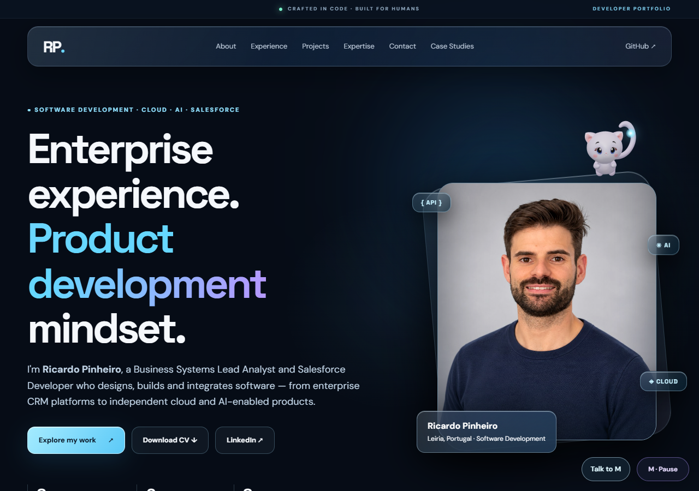
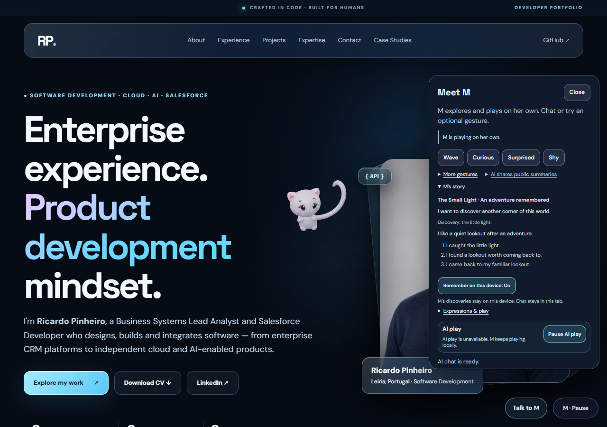

# M V26 — Persistent character continuity

Prepared on feat/m-character-continuity-v26 from published V25 main 4da82fb4.
This is a pre-publication record; the PR tracks later approval and deployment.

## Result

M now has an authored identity, an unfinished intention, remembered discoveries
and an established preference which survives a full browser close/reopen.
The Small Light chapter starts without a prompt: follow a self-generated light,
complete its three actual arrivals, discover it, find a quiet lookout and remember
that experience. On a later visit M attempts to revisit her familiar lookout.
After completing that intention she resumes varied V25 exploration and play.

The original V6 GLB, 31 bones, 10 tail bones, four skin sets with up to 14
influences, ten restored maps, six clips, materials and shoulder correctives are
unchanged. Existing locomotion, depth gates and text/click protection remain in
charge of physical execution. No alternate mascot or facial sculpture is used.

## Character state

m-world-character.mjs keeps a small versioned profile of M's own authored story
on this device. It stores approved event IDs, semantic places and chapter state;
chat, visitor identity, arbitrary messages and live DOM/route/pose objects are
excluded. It validates loads, retains a last-good snapshot, preserves unknown
future saves and falls back to RAM if storage fails. The device preference and
reset control affect only this story, leaving chat and AI accounting untouched.

A fixed page-incarnation visit ID and completed execution receipt prevent stale
or repeated callbacks advancing a goal. Proposal/acceptance is not completion.
Failed, cancelled and replaced work cannot invent a discovery. Missing favorite
components retain the memory while the local planner adapts or waits.

Persistent goals become considerations in the existing utility owner. They
respect reading, motion preference, energy, manual priority and offered actions.
When there is no visible mapped perch, M may establish a semantic quiet hover
region only after the existing planner finds text-clear room and a staged
performance actually completes there. A remembered region is replanned against
the new layout; old screen coordinates are never replayed.

## Dialogue and AI

The same strict eight-field character context reaches the optional UI, chat and
director. M's authored identity is curious, playful, observant and gently stubborn.
Fictional preferences and local experiences are distinct from portfolio facts,
visitor identity and verified global events. The model cannot mutate the chapter.

The new Worker advertises character.version 1. The frontend sends character
context only when this capability is present; the old Worker receives the old
request bodies. The current model, secret, quota namespace and six-attempt /
65-second client allowance are preserved, including the existing 80/day director
limit. Complete local adventures require no provider request. The new Worker is
prepared and compiled, not deployed in this record.

## Executed checks

- Full Node suite: 422/422 pass, including persistence, backup/corruption/future
  version handling, receipts, actual controller acknowledgement, missing targets,
  reset isolation, legacy/new APIs and stale-response rejection.
- Native Chrome desktop: 19/19 checks passed.
- Corrected mobile repetition: 21/21 checks passed, including two global checks.
  These are separate runs, not a single continuous combined run.
- Desktop and mobile both completed the first adventure with zero user input,
  then restored and genuinely revisited their lookout after Chrome was fully
  closed and relaunched with the same isolated profile. Full timings and saved
  state are in NATIVE_SUMMARY.json. Warm actual drawing was about 60 FPS, CPU p95
  about 3 ms on this machine; this is not a physical-phone performance claim.
- Remember/forget/reset, draft preservation, typing, reduced motion, responsive
  layout, original skinning and zero shader/JavaScript/asset errors were checked.
- A separate actual Chrome session passed 6/6 AI-transport checks. One mocked
  director reply was followed by real local chapter completion. Enter submitted
  the actual completed state to chat and the mocked memory-aware reply appeared
  in the UI. This validates integration, not the artistic quality of a real model
  response. No paid call was made.
- Wrangler 4.135.0 dry-run successfully bundled the Worker (40.94 KiB, gzip 11.58
  KiB); no deployment or secret inspection occurred.
- The committed portable native harness was then executed for mobile after the
  header paint fix: 21/21 checks passed in a separate run.
- Both viewport videos decoded and ended normally in native Chrome, at 1280x900.
  A repeated close/reopen recording also confirmed an unsent draft was not stored.

The first native run was 39/40. Its one assertion lost score zero because the
collection sliced away an already recorded warm-up. The corrected harness starts
first-adventure evidence at the beginning of that trace. Only mobile was repeated;
no product state, pose, arrival, clock or deadline was changed. The original record
is retained under work/M_V26_Character_Validation/.

Visual review found scrolled story text appearing above the sticky dialog header.
The header now covers its padding; fresh screenshots were reviewed after the fix.

The first hosted legacy render check found a queued autonomous gesture replacing
an explicit diagnostic perch route. An actual-controller test reproduced it before
the fix. playAction now releases the autonomous owner first. Native Chrome then
reached physical foot contact and stayed attached across a real 55px page scroll:
64 contact samples, maximum gap 0.97px. The diagnostic did not award a discovery.
The untouched adventure code path is unchanged by this diagnostic handoff fix.

## Native reproduction

Serve the repository on a loopback origin (default http://127.0.0.1:4186/).
Install/use Playwright and native Chrome, or set PLAYWRIGHT_MODULE and CHROME_BIN.
Run node m-world-v26-browser.mjs. M_WORLD_ARTIFACT_DIR controls the output folder;
the default is a temporary directory. M_WORLD_V26_PROFILE can select desktop or
mobile. This harness uses real native rendering and does not simulate a fast
software-GPU clock. It intercepts all paid endpoints and never injects progress.

## Captures

[First autonomous adventure, about 28 seconds](first-adventure.webm)

[Later visit, about 12 seconds](return-visit.webm)

These are actual viewport captures at average source cadence. Individual source
timestamps remain with the local recordings. FPS measurements were taken without
the viewport recorder.

## Limits and rollout

The story currently lives on this browser/device, with one authored chapter. It
is not a shared global world, cross-device identity, a continuously running
creature while the computer is off or evidence of consciousness. Preferences
and experiences are authored fiction backed by bounded software state. The
original morphs still limit facial range.

Physical phones, Safari/iOS, real IME and OS background-tab behavior remain to be
verified. Real provider wording in the new persona needs a bounded live check
after an approved Worker rollout. The current source wrangler.jsonc has the
original default autoplay=false; a future approved rollout must preserve the
live enabled setting, model, secret, bindings and quotas rather than blindly
replace them with defaults. Frontend and Worker publication require explicit
owner approval. The same-thread continuation heartbeat is active every 30 minutes
and must respect this release gate.
