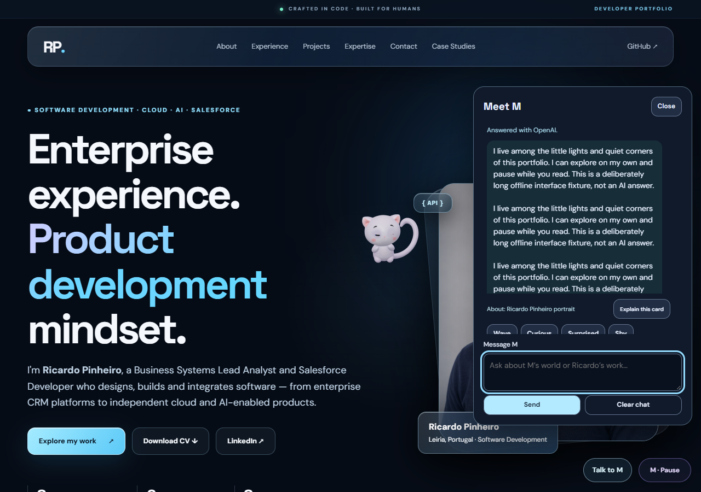
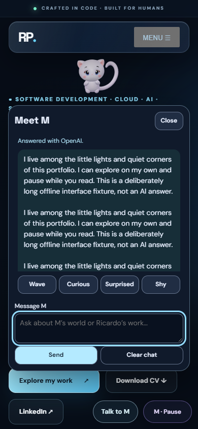

# M V27 — Readable chat and autonomous living routines

Prepared on feat/m-living-routines-v27 from published V26 d667748.
This version is not published. Original GLB, textures, materials, full skinning,
31-bone rig and shoulder correctives are preserved. Target: desktop/mobile web;
Godot validation is not applicable.

## Readable conversation — first priority

The old response log was the only panel child allowed to shrink, with min-height0.
Fixed controls could therefore reduce a reply to one line. The new dialog keeps a
header and composer around a scrollable body, puts the conversation first and
reserves real reading space. Word wrapping removes horizontal overflow. The
latest long answer starts at its first line; all history remains scrollable.

Actual Chrome checks with 700-character ordinary and unbroken fixture replies:
280 px desktop,240 px mobile390 x 844,192 px small320 x 568,160 px with a simulated reduced
visual viewport. The composer and Send remain hit-testable, including with all
optional controls expanded. Enter submits; Shift+Enter keeps a newline. Whole-app
Chrome checks also confirmed280/240 px with the original 31-bone M loaded.

## New performances and decisions

- Sleep12.4 s: original HAT eyelids close progressively, hold, breathe and reopen;
  subtle original-joint body/ear/tail movement, no eye scaling or new facial mesh.
- Hop3.5 s: preparation, push, bounded lift, recovery and landing. Real lifted pose
  samples contribute to framing; neutral translation is restored every update.
- Think4.2 s: small searching looks, head/ear response and a decision beat.
- Paw3.2 s: a gentle bat synchronized to the original hand projection.
- Pondering, dozing and joyful use only blends of the original expression morphs.

The same single utility owner chooses these routines using energy, curiosity,
play need and a bounded 90-second nap urge. Only a successfully completed sleep
reduces that urge. Proposals, failed/cancelled actions and memory reset do not
pretend that M rested. Reading, typing, selection, scroll, reduced motion, manual
priority and spatial feasibility still take precedence. New local gestures do
not widen the provider's action vocabulary or request allowance.

The floating-ball game completes three real paw contacts. Its shaded prop follows
the original hand at contact and a bounded asymmetric curved return. It remains
visible between rallies and blends into the next paw position. The conservative
flight planner and per-frame checks protect text, header and viewport. Changed
space cancels cleanly, clears the prop and releases the owned expression. This
is an authored floating-ball performance, not a general rigid-body physics engine.

## Actual native observation and visual review

The desktop observation recorded 1594 samples over about 163 s with ZERO user inputs
or M action/pose/route/progress/clock commands. M independently completed the light
chapter, a safe lookout, inspection/hide-and-seek, a full0->1->2->3 ball game,
sleep with both eyes closed and a hop reaching lift 0.1599. No failed autonomous
execution was reported in that window. Think was not randomly observed during
that trace; it was verified separately as an explicitly requested diagnostic.

Desktop and emulated mobile diagnostics exercised sleep, hop, thinking and all
three ball taps, full-actor framing, text protection, typing cancellation and
reduced-motion cleanup. Screenshots were visually reviewed. Warm drawing without
recording was about 60 FPS, desktop CPU p95 4 ms and emulated-mobile about 3.7 ms on
this machine; these are not physical-phone measurements.

[Real three-tap ball diagnostic, about 11.5 seconds](floating-ball.webm)

The video contains 331 original CDP frames, encoded at average source cadence with
timestamps retained outside the repository. It decoded normally in native Chrome
at 1280 x 900. The play controls in this clip identify an explicitly requested game;
the separate natural trace/capture proves the same game also starts without input.
It is not a performance benchmark.

## Tests and diagnosed issues

- Full Node suite 482/482 passed.
- Chat unit 31/31 and isolated native layout 42/42 passed.
- Actual ball/controller 31/31, pure ball 12/12 (25,005 safe arc samples),
  acting/affect 23/23, autonomy 29/29 and focused backend 68/68 passed.
- First whole-app native run 35/37: desktop 19/19; mobile motion and long-reply
  checks passed, then a test helper attempted ballplay during the assistant's
  existing expression hold. Production rejected it as designed. The helper now
  waits for gesture, expressionHold AND pending intent. Only affected mobile
  interactions were repeated:10/10 passed. The original record is retained;
  these are separate runs, not an invented combined uninterrupted pass.
- Initial encoder failures were diagnosed as a minimal bundled ffmpeg lacking
  VP9/image2 pattern input and requiring an explicit MJPEG decoder for image2pipe.
  The original 331 frames were encoded successfully; no browser capture repeated.
- Wrangler 4.135 dry-run passed 45.28 KiB/gzip 13.07 KiB. No deployment/secret read.
- Independent read-only reviews found no remaining blocking integration issue.

## Hosted text-shield regression

The first hosted legacy render passed 28/29 checks but exposed one changed pixel
inside the protected paragraph region (device 653,1026; CSS 326.75,513.25; delta 46).
The surrounding 11x11 pixels were unchanged. The installed native Chrome baseline
had zero changed protected-interior pixels, so it did not reproduce the Linux
raster result; a rounded fan junction is strongly indicated, not proven by that
native comparison. Original CI and native evidence are retained outside the repo.

Protected text/control bounds now use a solid two-triangle depth quad, while card
surfaces retain their rounded geometry. This conservatively covers the full safety
rectangle and removes the many-triangle junction. A geometry regression failed
before the change (168 versus 12 coordinates) and the full 482-test suite passed
afterward. Pixel thresholds and protected-interior insets remain unchanged. A fresh targeted native comparison covered 89,184 interior pixels with zero
front/empty or behind/empty differences and no page errors, using the same actor
position as the failing CI. The latest exact-head hosted result is tracked in
the PR and workspace completion report.

## AI wording, limits and rollout

The backend now distinguishes actual encounter events from the currently focused
card. An unknown light location stays unknown in derived facts. Portuguese wording
rules avoid exposing English internal state names. Section suggestions require
explicit navigation intent, both in the dynamic response schema and after output
validation. Reply text and gesture/expression fields remain the original contract.
Model, secrets, Durable Object identity and quotas are unchanged; no paid calls
were made for this iteration. Natural-language factuality/localization still needs
representative real-provider review after an approved rollout; mocked tests do
not establish artistic or linguistic approval.

Physical phones, Safari/iOS, actual OS keyboards/IME and background transitions
remain untested. The story remains per-device with the original authored chapter;
new routines do not fabricate new chapter achievements. Existing morphs limit the
facial range. This is bounded authored software autonomy, not consciousness.

Before publication, review the PR and all hosted checks, then obtain explicit owner
approval for the new merge and Worker update. An approved rollout must preserve
live autoplay=true rather than use the historical source default=false, and keep
the current model/key/bindings/quotas. Suggested squash commit:
feat(m-world): add readable chat and autonomous living routines.
