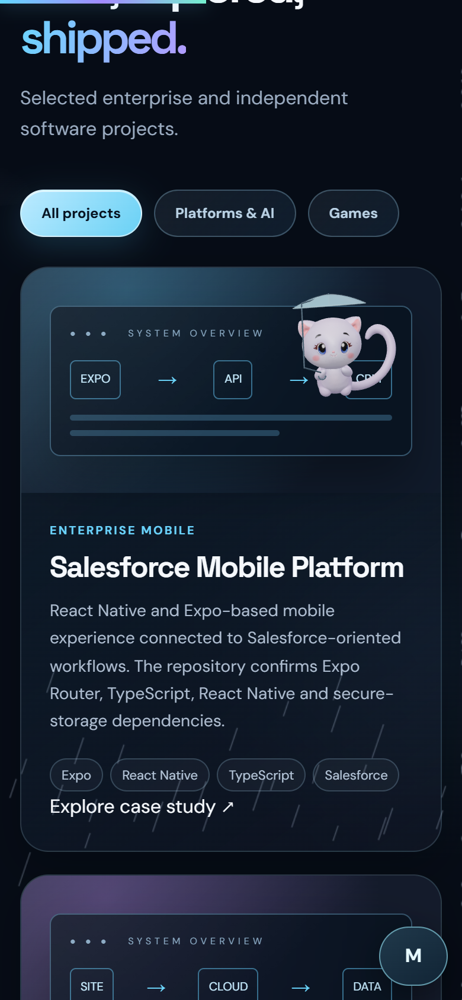
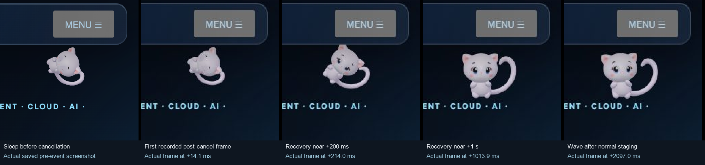

# M — coherent weather presence and gesture recovery

Implemented on `feat/m-weather-presence`, based on V69 and synchronized with
`main`'s reviewed daily discovery update (`bc3acdd`). No merge or publication is
included in this development checkpoint.

When M passed behind a portfolio card, the umbrella could cross its depth plane
and remain visible over the card. The complete original actor and accessory now
share the same card stencil, while retaining internal depth and original PBR
materials. Unsupported stencil contexts use the existing safe foreground planner.

The separate umbrella follows the actual posed paw. Its thin curved canopy clears
sampled original head/ear tips, the shaft runs beside the face, and opening,
folding and wind retain continuous state. The first geometry review found a shaft
crossing an eye; that failed version was preserved and corrected before acceptance.

Interrupted gestures now retain their outgoing visual joint, eyelid and lift
offsets while settling into the next pose. Authored timing, contact cues and action
ownership remain unchanged. Visual recovery never awards a completed experience.

The sheet contains actual saved frames, with spatial resizing only. The incoming
wave starts after normal staging; this is not instantaneous gesture admission or
a physical-device input test.

A single cached public forecast profile now feeds existing local utility weights,
real energetic effort and shared expressive presentation. Rain and wind mildly
favour observation, thinking and shelter over exposed play. Sleep, achievements,
persistent goals, accepted intentions, cooldowns and input safety retain priority.
Weather does not drain idle energy or create remembered facts. Missing/invalid
weather preserves the previous deterministic behavior. Existing mood, gaze, body,
tail and facial systems consume the bounded presentation context; no new executor
or unrelated animation layer was added.

Professional reply guards now respect the resolved PT/EN/ES/FR question language.
A Portuguese Contact question remains Portuguese with an English interface, and
localized fallbacks reuse only approved public role, capability and contact facts.
Mocked handler checks prove one provider request instead of an unnecessary language
repair request. LinkedIn access and unknown-information rules are unchanged.

Validation completed on 11–12 November 2026:

| Check | Actual result |
| --- | --- |
| Complete existing Node workflow command | **850/850 passed**, no failures, cancellations or skips |
| Original-model umbrella revision | **25/25 native checks passed**, desktop/mobile emulation |
| Interrupted-gesture capture | **17/17 passed**, 604 native RAF samples and four short videos |
| Unforced coupled weather/autonomy capture | **21/21 passed**, 20 s desktop /15 s mobile |
| M companion bundle | Wrangler 4.151.2 `deploy --dry-run`, exit 0; 108.84 KiB /31.11 KiB gzip |
| Existing analytics bundle | Same offline validation, exit 0; 15.27 KiB /5.91 KiB gzip |

Initial failed visual versions and regression logs remain preserved in the chat
workspace. Final VM fixtures use the actual weather multiplier and test unchanged
idle/sleep recovery plus bounded storm effort on a genuinely accepted route. Their
existing ownership and accessibility assertions were retained.

Moving behind-card samples had zero unwanted card-interior alpha in 31 desktop
and 21 eligible mobile samples; foreground controls stayed positive and blank/GL
error controls were zero. The original 29 asset hashes, 31 bones, 14 influences,
four skin sets, 10 maps, six clips, correctives and approved HAT eyes are preserved.
Portfolio design/content/navigation and mobile Ask M remain unchanged.

Real unforced inspect/wink and follow-light intentions survived a forecast change
for 40 native frames, then completed through their actual owners. Forecast
assignment itself left memory/completion counters unchanged. Typing, manual gesture
priority, null fallback and reduced motion passed separate controlled checks.

Rain revision windows measured about 60 FPS and 4 ms CPU-frame p95. Separate final
clear-weather windows measured 58.84/60.13 FPS and 3.2/3.1 ms CPU-frame p95. Different
weather/actions prevent a causal speed comparison. Geometry and update vectors are
reused, head probing is bounded to nine points on wet frames, forecast normalization
is cached, and gesture derivatives are sampled only on interruptions. No measured
hotspot justified another optimization or dependency.

Physical phones, Safari and long resource/thermal trends remain unverified.
Existing rounded DOM mask proxies can differ from tilted decorative contours;
general CSS contour matching is not provided. Head-tip sampling is a bounded clearance probe,
not general collision detection. One extra off-viewport diagnostic was explicitly
excluded from visual coverage. Small weather expression differences were not
isolated causally from concurrent natural motion. All forecasts in visual evidence
are labelled DEMO; no real or paid provider request was made during development.

No backend URL, model, key, quota, binding, migration, Cron, service or production
configuration was changed. Both bundle checks were offline, not deployments.
Production publication requires explicit approval of the concrete PR, followed by
actual GitHub Pages and existing Worker deployment verification.

Completed implementation commits: `1bca870`, `995f562`, `b5a36bf`, `c4b9ee5`,
`b45b60a` and `c306042`. Suggested release/PR title:
`feat(m): coherent weather, movement and localized replies`.

Implementation: [renderer](../../m-world-3d.mjs),
[umbrella](../../m-world-umbrella.mjs),
[gesture handoff](../../m-world-gesture-handoff.mjs),
[forecast behavior](../../m-world-weather-behavior.mjs),
[shared presentation](../../m-world-character-state.mjs) and
[professional replies](../../m-ai/professional-guide.mjs).
